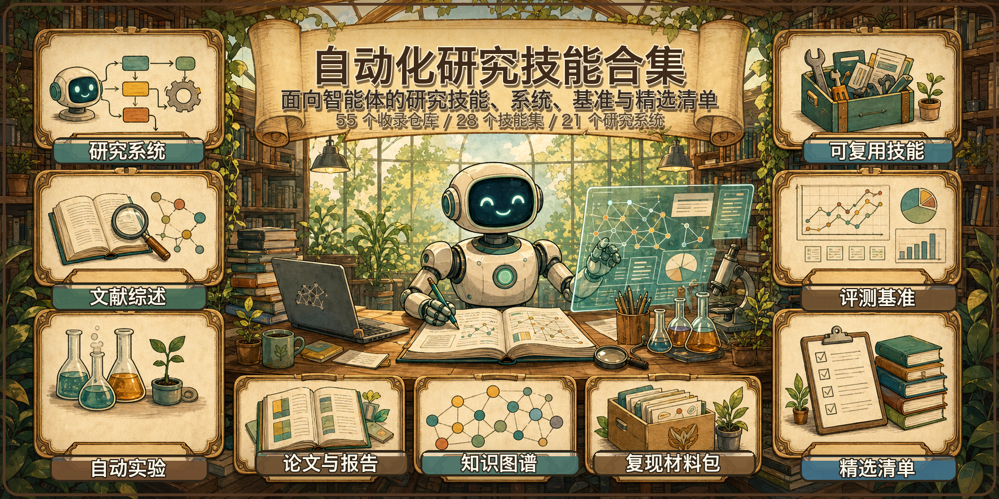

<div align="center">
  
</div>

<h1 align="center">Auto-Research-Skills</h1>

<p align="center">
  <b>自动化研究 <i>技能</i> 与智能体的精选合集</b> —— 从想法 → 实验 → 论文，全程自动驾驶。
</p>

<p align="center">
  <a href="#-研究技能与插件合集"></a>
</p>

<p align="center"><b>🧩 已收录 5,897 个 skills</b>，分布在 <b>87 个仓库</b> 中 —— 一次克隆拿到整套研究工具箱。</p>

<p align="center">
  <a href="#-研究技能与插件合集"></a>
  <a href="#"></a>
  <a href="LICENSE"></a>
  
  <a href="CONTRIBUTING.md"></a>
  <a href="https://github.com/brycewang-stanford/StatsPAI"></a>
</p>

<p align="center"><a href="README_EN.md">English</a> · <b>简体中文</b></p>

---

### ⭐ 重点技能

> **[Imbad0202/academic-research-skills](https://github.com/Imbad0202/academic-research-skills)** &nbsp;·&nbsp; ~52.7k ⭐ &nbsp;·&nbsp; 🧩 已收录
> 面向 Claude Code 的学术研究技能集 —— 完整的 **research → write → review → revise → finalize** 流水线，覆盖文献综述与同行评审。收录于 [`skills/academic-research-skills`](skills/academic-research-skills)。

---

## 🏆 Star 排行榜 Top 20

<!-- TOP20:START -->
> 按 GitHub star 数排名的前 20 个已收录仓库，由 [`scripts/update-stars.py`](scripts/update-stars.py) 每周自动刷新（最近：2026-10-20）。完整榜单见 [STARS.md](STARS.md)。

| # | 仓库 | ⭐ Stars | 类别 | 收录位置 |
|:-:|---|--:|:-:|---|
| 🥇 | [bytedance/deer-flow](https://github.com/bytedance/deer-flow) | 84.2k | 系统 | [`systems/deer-flow`](systems/deer-flow) |
| 🥈 | [mvanhorn/last30days-skill](https://github.com/mvanhorn/last30days-skill) | 64.8k | 技能 | [`skills/last30days`](skills/last30days) |
| 🥉 | [Imbad0202/academic-research-skills](https://github.com/Imbad0202/academic-research-skills) | 53.0k | 技能 | [`skills/academic-research-skills`](skills/academic-research-skills) |
| 4 | [K-Dense-AI/scientific-agent-skills](https://github.com/K-Dense-AI/scientific-agent-skills) | 53.0k | 技能 | [`skills/scientific-agent-skills`](skills/scientific-agent-skills) |
| 5 | [Yuan1z0825/nature-skills](https://github.com/Yuan1z0825/nature-skills) | 49.4k | 技能 | [`skills/nature-skills`](skills/nature-skills) |
| 6 | [stanford-oval/storm](https://github.com/stanford-oval/storm) | 31.7k | 系统 | [`systems/storm`](systems/storm) |
| 7 | [assafelovic/gpt-researcher](https://github.com/assafelovic/gpt-researcher) | 30.2k | 系统 | [`systems/gpt-researcher`](systems/gpt-researcher) |
| 8 | [dzhng/deep-research](https://github.com/dzhng/deep-research) | 19.8k | 系统 | [`systems/deep-research`](systems/deep-research) |
| 9 | [wanshuiyin/Auto-claude-code-research-in-sleep](https://github.com/wanshuiyin/Auto-claude-code-research-in-sleep) | 17.7k | 技能 | [`skills/aris`](skills/aris) |
| 10 | [HKUDS/DeepCode](https://github.com/HKUDS/DeepCode) | 16.7k | 系统 | [`systems/deepcode`](systems/deepcode) |
| 11 | [SakanaAI/AI-Scientist](https://github.com/SakanaAI/AI-Scientist) | 14.8k | 系统 | [`systems/ai-scientist`](systems/ai-scientist) |
| 12 | [aiming-lab/AutoResearchClaw](https://github.com/aiming-lab/AutoResearchClaw) | 14.7k | 系统 | [`systems/autoresearchclaw`](systems/autoresearchclaw) |
| 13 | [Orchestra-Research/AI-Research-SKILLs](https://github.com/Orchestra-Research/AI-Research-SKILLs) | 13.7k | 技能 | [`skills/ai-research-skills`](skills/ai-research-skills) |
| 14 | [Imbad0202/academic-research-skills-codex](https://github.com/Imbad0202/academic-research-skills-codex) | 13.2k | 技能 | [`skills/academic-research-skills-codex`](skills/academic-research-skills-codex) |
| 15 | [langchain-ai/open_deep_research](https://github.com/langchain-ai/open_deep_research) | 12.7k | 系统 | [`systems/open-deep-research`](systems/open-deep-research) |
| 16 | [HKUSTDial/Supervisor-Skills](https://github.com/HKUSTDial/Supervisor-Skills) | 10.1k | 技能 | [`skills/supervisor-skills`](skills/supervisor-skills) |
| 17 | [companion-inc/feynman](https://github.com/companion-inc/feynman) | 10.0k | 技能 | [`skills/feynman`](skills/feynman) |
| 18 | [Future-House/paper-qa](https://github.com/Future-House/paper-qa) | 9.4k | 系统 | [`systems/paper-qa`](systems/paper-qa) |
| 19 | [LearningCircuit/local-deep-research](https://github.com/LearningCircuit/local-deep-research) | 9.4k | 系统 | [`systems/local-deep-research`](systems/local-deep-research) |
| 20 | [Master-cai/Research-Paper-Writing-Skills](https://github.com/Master-cai/Research-Paper-Writing-Skills) | 7.6k | 技能 | [`skills/paper-writing-skills`](skills/paper-writing-skills) |
<!-- TOP20:END -->

---

> **这是什么？** 一个社区精选的**自动化研究**中心 —— 收纳可复用技能（skills）、端到端系统（systems）、领域科学智能体、评测基准（benchmarks）、以及精选清单（lists），打包好让编码智能体（Claude Code、Codex、OpenClaw 及任意 LLM agent）直接调用。**5,897 个 skills**、分布在 **87 个仓库**中，以 **git 子模块**（浅克隆）形式收录，分别放在 [`skills/`](skills/)、[`systems/`](systems/)、[`benchmarks/`](benchmarks/)、[`lists/`](lists/) 四个目录，一次克隆即可拿到整套工具箱。

```bash
# 推荐：先克隆，再让 setup.sh 处理顶层与嵌套子模块
git clone https://github.com/brycewang-stanford/Auto-Research-Skills.git
cd Auto-Research-Skills
./setup.sh

# 已经克隆过？补齐缺失子模块
./setup.sh
```

> 📊 实时排名见 [**STARS.md**](STARS.md) —— 由 [GitHub Action](.github/workflows/update-stars.yml) 每周自动刷新。
>
> 🧭 候选收录与筛选标准见 [**CURATION.md**](CURATION.md)：里面记录了通过 registry/GitHub 调研发现的候选 skills、评审标准与安全检查清单。
>
> 🗺️ 想了解整个自动化科研生态的全景，以及本仓库四个目录的划分逻辑，见 [**docs/landscape-2026.md**](docs/landscape-2026.md)（领域地图）。
>
> 🛠️ 维护者提交前建议运行 `make check`（或 [`CONTRIBUTING.md`](CONTRIBUTING.md) 中列出的等价命令）。`setup.sh` 会先初始化顶层子模块，再尽力初始化上游仓库声明过的嵌套子模块，避免单个上游嵌套映射问题阻塞整个 checkout。
>
> ⚠️ 不建议把所有 `skills/` 子模块一次性装进同一个 agent profile：不同集合里有不少同名但内容不同的技能，按名称解析时胜出者可能不确定。组合安装前请看 [`catalog/collisions.json`](catalog/collisions.json)，或启动本地静态服务后打开 [`site/collisions.html`](site/collisions.html)。

## 目录

- [🏆 Star 排行榜 Top 20](#-star-排行榜-top-20)
- [🧠 端到端自主研究系统](#-端到端自主研究系统)
- [🔎 深度研究与文献综合](#-深度研究与文献综合)
- [🧪 自动化实验与代码智能体](#-自动化实验与代码智能体)
- [🔬 领域科学智能体](#-领域科学智能体)
- [🧩 研究技能与插件合集](#-研究技能与插件合集)
- [📊 评测基准](#-评测基准)
- [📚 精选清单与综述](#-精选清单与综述)
- [🗂️ 已收录仓库（子模块）](#️-已收录仓库子模块)
- [🤝 贡献](#-贡献)
- [📄 协议](#-协议)

> **图例：** ⭐ = 约略 star 数 · 🧩 = 已作为子模块收录
> **说明：** 权威收录清单见 [已收录仓库](#️-已收录仓库子模块)。在“研究技能与插件合集”表中，未标记的项目是候选或相邻参考项目。

---

## 🧠 端到端自主研究系统

> 自动化**完整**研究生命周期的项目：想法 → 实验 → 论文 → 评审。

| 项目 | ⭐ | 技术栈 | 说明 |
|---|---|---|---|
| [karpathy/autoresearch](https://github.com/karpathy/autoresearch) | ~98.1k | Python | Karpathy 的过夜研究循环：AI 智能体在单卡 nanochat LLM 训练上自动提出、运行并评估实验。 |
| [SakanaAI/AI-Scientist](https://github.com/SakanaAI/AI-Scientist) | ~14.8k | Python | 提想法、跑实验、写论文并自动评审。 |
| [aiming-lab/AutoResearchClaw](https://github.com/aiming-lab/AutoResearchClaw) | ~14.7k | Agent | 全自主、自进化研究，从想法到论文。 |
| [SakanaAI/AI-Scientist-v2](https://github.com/SakanaAI/AI-Scientist-v2) | ~7.4k | Python | v2 —— 智能体树搜索，产出 workshop 级论文，更少模板约束。 |
| [SamuelSchmidgall/AgentLaboratory](https://github.com/SamuelSchmidgall/AgentLaboratory) | ~5.9k | Python | LLM 智能体充当研究助理，覆盖完整流水线。 |
| [HKUDS/AI-Researcher](https://github.com/HKUDS/AI-Researcher) | ~5.8k | Python | NeurIPS 2025 —— 自主科学创新，从想法到论文。 |
| [EvoScientist/EvoScientist](https://github.com/EvoScientist/EvoScientist) | ~5.0k | Python | 自进化多智能体 AI 科学家，持久记忆驱动的「vibe research」。 |
| [ResearAI/DeepScientist](https://github.com/ResearAI/DeepScientist) | ~3.4k | TS · Python | 本地优先的自主研究工作室：基线复现 → 实验 → 论文级产出。 |
| [OpenNSWM-Lab/FAROS](https://github.com/OpenNSWM-Lab/FAROS) | ~3.0k | Python | 蓝图驱动的 AutoResearch 运行时：想法 → 实验 → 写作 → 同行评审。 |
| [InternScience/InternAgent](https://github.com/InternScience/InternAgent) | ~1.5k | Python | 统一 agentic 框架，面向长时程、跨领域的自主科学发现。 |
| [OpenRaiser/NanoResearch](https://github.com/OpenRaiser/NanoResearch) | ~1.3k | Python | 轻量级自主 AI 研究助手（skills/agent 驱动），从选题到端到端研究。 |
| [zhu-minjun/Researcher](https://github.com/zhu-minjun/Researcher) | ~406 | Python | CycleResearcher —— 通过自动评审改进自动研究的迭代循环。 |
| [Sibyl-Research-Team/AutoResearch-SibylSystem](https://github.com/Sibyl-Research-Team/AutoResearch-SibylSystem) | ~287 | Claude Code | 自进化自主研究系统，原生构建于 Claude Code。 |
| [ulab-uiuc/research-town](https://github.com/ulab-uiuc/research-town) | ~214 | Python | ICML 2025 —— 模拟人类科研社区的多智能体。 |
| [tsinghua-fib-lab/OmniScientist](https://github.com/tsinghua-fib-lab/OmniScientist) | ~207 | Python | AI 科学家生态，编码人类科研基建以自动化想法、文献、实验与写作。 |

## 🔎 深度研究与文献综合

> 自动化信息收集、文献综述、带引用的报告生成。

| 项目 | ⭐ | 技术栈 | 说明 |
|---|---|---|---|
| [bytedance/deer-flow](https://github.com/bytedance/deer-flow) | ~84.1k | LangGraph | 深度研究，支持人机协同。 |
| [stanford-oval/storm](https://github.com/stanford-oval/storm) | ~31.7k | Python | 维基百科式长篇报告合成（斯坦福）。 |
| [assafelovic/gpt-researcher](https://github.com/assafelovic/gpt-researcher) | ~30.2k | Python | 规划 → 抓取 → 带引用报告。经典之作。 |
| [dzhng/deep-research](https://github.com/dzhng/deep-research) | ~19.8k | TypeScript | 最简实现的迭代式深度研究智能体，能自我修正研究方向。 |
| [langchain-ai/open_deep_research](https://github.com/langchain-ai/open_deep_research) | ~12.7k | LangGraph | 开源、可配置的深度研究智能体。 |
| [Future-House/paper-qa](https://github.com/Future-House/paper-qa) | ~9.4k | Python | PaperQA2 —— 对科学 PDF 做高准确率、带引用的 RAG 问答。 |
| [LearningCircuit/local-deep-research](https://github.com/LearningCircuit/local-deep-research) | ~9.3k | Python | 本地、隐私优先的深度研究；接入 arXiv + PubMed，SimpleQA 约 95%。 |
| [nickscamara/open-deep-research](https://github.com/nickscamara/open-deep-research) | ~6.3k | TypeScript | 开源深度研究复刻，基于 Firecrawl 抓取的网页数据推理。 |
| [HKUDS/Auto-Deep-Research](https://github.com/HKUDS/Auto-Deep-Research) | ~1.8k | Agent | 低成本、全自动的个人研究助手。 |
| [AkariAsai/OpenScholar](https://github.com/AkariAsai/OpenScholar) | ~1.7k | Python | 检索增强的科学文献综合系统，生成带引用的答案（AllenAI/UW）。 |
| [khoj-ai/openpaper](https://github.com/khoj-ai/openpaper) | ~504 | TypeScript | 研究论文库工作台：阅读、标注、AI 文献综述一站式完成。 |
| [AutoSurveys/AutoSurvey](https://github.com/AutoSurveys/AutoSurvey) | ~478 | Python | 多阶段流水线，自动生成文献综述。 |

## 🧪 自动化实验与代码智能体

> 编码、实验执行、迭代优化全程自动。

| 项目 | ⭐ | 技术栈 | 说明 |
|---|---|---|---|
| [HKUDS/DeepCode](https://github.com/HKUDS/DeepCode) | ~16.7k | Python | 开源智能编码：论文转代码（Paper2Code）+ Text2Web + Text2Backend。 |
| [going-doer/Paper2Code](https://github.com/going-doer/Paper2Code) | ~5.0k | Python | PaperCoder —— 将 ML 论文自动转为可运行的代码仓库。 |
| [ruc-datalab/DeepAnalyze](https://github.com/ruc-datalab/DeepAnalyze) | ~4.7k | Python | 号称首个自主数据科学 agentic LLM：自动分析海量数据并一键生成专业分析报告。 |
| [TheBlewish/Automated-AI-Web-Researcher-Ollama](https://github.com/TheBlewish/Automated-AI-Web-Researcher-Ollama) | ~3.0k | Ollama | 基于本地 LLM 的自动网络研究员。 |
| [starpig1129/DATAGEN](https://github.com/starpig1129/DATAGEN) | ~1.8k | LangGraph | AI 驱动的多智能体研究助手，自动化假设生成、数据分析与报告写作。 |
| [WecoAI/aideml](https://github.com/WecoAI/aideml) | ~1.6k | Python | AIDE —— ML 工程智能体，把建模当作代码优化搜索。 |
| [Xiangyue-Zhang/auto-deep-researcher-24x7](https://github.com/Xiangyue-Zhang/auto-deep-researcher-24x7) | ~1.1k | Agent | 7×24 跑深度学习实验，Leader-Worker，常量内存。 |
| [Just-Curieous/Curie](https://github.com/Just-Curieous/Curie) | ~371 | Python | 严谨、可复现的 ML 研究实验智能体。 |
| [snap-stanford/POPPER](https://github.com/snap-stanford/POPPER) | ~297 | Python | 自动化假设检验：基于波普尔「序贯证伪」思想的多智能体框架（Stanford SNAP）。 |

## 🔬 领域科学智能体

> 在特定领域（生物、化学、多智能体实验室）开展真实科研工作的智能体。

| 项目 | ⭐ | 领域 | 说明 |
|---|---|---|---|
| [snap-stanford/Biomni](https://github.com/snap-stanford/Biomni) | ~4.0k | 生物医学 | 通用生物医学 AI 智能体，覆盖 150+ 工具/数据库。 |
| [ur-whitelab/chemcrow-public](https://github.com/ur-whitelab/chemcrow-public) | ~965 | 化学 | 面向合成、药物发现、材料的 LLM 化学智能体。 |
| [zou-group/virtual-lab](https://github.com/zou-group/virtual-lab) | ~753 | 多智能体 | 一支 LLM「科学家」团队开展跨学科研究（斯坦福）。 |
| [Future-House/robin](https://github.com/Future-House/robin) | ~743 | 生物医学 | 多智能体科学发现；提出并验证了干性 AMD 候选药。 |
| [lamm-mit/SciAgentsDiscovery](https://github.com/lamm-mit/SciAgentsDiscovery) | ~638 | 材料 | MIT —— 多智能体自动科学发现与假设生成。 |
| [GENTEL-lab/OriGene](https://github.com/GENTEL-lab/OriGene) | ~230 | 生物医学 | 自进化多智能体「虚拟疾病生物学家」，机制引导的治疗靶点发现（非商用许可）。 |
| [gomesgroup/coscientist](https://github.com/gomesgroup/coscientist) | ~212 | 化学 | 基于 LLM 的自主化学研究（Nature 2023）。 |

## 🧩 研究技能与插件合集

> 可直接接入编码智能体的可复用技能集与插件。

| 项目 | ⭐ | 技术栈 | 说明 |
|---|---|---|---|
| [Imbad0202/academic-research-skills](https://github.com/Imbad0202/academic-research-skills) 🧩 ⭐ | ~52.7k | Claude Code · Python | **重点。** 学术研究 → 写作 → 评审 → 修订 → 定稿流水线。 |
| [Yuan1z0825/nature-skills](https://github.com/Yuan1z0825/nature-skills) 🧩 | ~49.1k | Claude Code · Python | Nature 级学术表达 + 科研绘图，Claude 与 Codex 双支持。 |
| [wanshuiyin/Auto-claude-code-research-in-sleep](https://github.com/wanshuiyin/Auto-claude-code-research-in-sleep) 🧩 | ~17.7k | Markdown skills | ARIS —— 跨模型互审循环、想法发现、实验自动化，无框架锁定。 |
| [companion-inc/feynman](https://github.com/companion-inc/feynman) 🧩 | ~10.0k | CLI · Codex · Claude Code | 开源 AI 研究 agent（CLI，基于 Pi + alphaXiv）：文献综述、深度研究、复现、同行评审等 20 个研究 skill，可装进 Codex/Claude。 |
| [uditgoenka/autoresearch](https://github.com/uditgoenka/autoresearch) 🧩 | ~6.6k | Claude Code · Shell | Claude 自主研究 skill：受 Karpathy autoresearch 启发的自主目标迭代，内置命令安全护栏（拒绝 mkfs/dd/nc 等危险命令）。 |
| [Galaxy-Dawn/claude-scholar](https://github.com/Galaxy-Dawn/claude-scholar) 🧩 | ~5.8k | Claude Code · MCP | 半自动科研助手；集成 Zotero + Obsidian + MCP。 |
| [54yyyu/zotero-mcp](https://github.com/54yyyu/zotero-mcp) 🧩 | ~5.5k | MCP · Python | 把 Zotero 文献库接入任意 MCP 智能体：讨论论文、生成摘要、分析引用。 |
| [blazickjp/arxiv-mcp-server](https://github.com/blazickjp/arxiv-mcp-server) 🧩 | ~3.2k | MCP | 在任意支持 MCP 的智能体中直接检索与抓取 arXiv 论文。 |
| [openags/paper-search-mcp](https://github.com/openags/paper-search-mcp) | ~2.9k | MCP · Python | 跨 arXiv/PubMed/bioRxiv/medRxiv 等多源检索与下载论文的 MCP + CLI + skills。 |
| [K-Dense-AI/claude-scientific-writer](https://github.com/K-Dense-AI/claude-scientific-writer) 🧩 | ~2.5k | Claude Code · Python | 通用型科研写作助手。 |
| [AIScientists-Dev/academic-humanizer](https://github.com/AIScientists-Dev/academic-humanizer) | ~2.2k | Claude · Codex · MorphMind | 去除论文与 NSF/NIH 基金申请中的「AI 味」，保留学术语气并把论点绑定到证据。 |
| [pedrohcgs/claude-code-my-workflow](https://github.com/pedrohcgs/claude-code-my-workflow) 🧩 | ~1.7k | Claude Code · LaTeX/R | 学者用的可 fork 模板：多智能体评审、质量门、复现协议。 |
| [lishix520/academic-paper-skills](https://github.com/lishix520/academic-paper-skills) 🧩 | ~1.4k | Claude Code · Python | 系统化的学术论文规划与写作框架。 |
| [LeonChaoX/qinyan-academic-skills](https://github.com/LeonChaoX/qinyan-academic-skills) | ~964 | Claude Code · Python | 「沁言」学术科研库 —— 177 个研究 Agent。 |
| [mshumer/autonomous-researcher](https://github.com/mshumer/autonomous-researcher) 🧩 | ~826 | Agent | 轻量级自主研究智能体。 |
| [andrehuang/research-companion](https://github.com/andrehuang/research-companion) 🧩 | ~721 | Claude Code | 战略型科研思考智能体：选题评估、项目分诊、头脑风暴。 |
| [Light0305/Light-skills](https://github.com/Light0305/Light-skills) 🧩 | ~659 | Claude Code · Codex | 全流程科研技能包：28 个技能覆盖调研 → 写作 → 审稿 → 投稿，配套 9 个可核查知识库与对抗式自检。 |
| [Boom5426/Nature-Paper-Skills](https://github.com/Boom5426/Nature-Paper-Skills) 🧩 | ~596 | Claude Code · TeX | Nature 风格论文的起草、修订、审稿与返修技能。 |
| [EvoScientist/EvoSkills](https://github.com/EvoScientist/EvoSkills) | ~481 | Agent Skills | 面向 EvoScientist 式科学工作流的可安装技能与知识包。 |
| [jamditis/claude-skills-journalism](https://github.com/jamditis/claude-skills-journalism) 🧩 | ~423 | Claude Code | 新闻/媒体/学术交叉的技能集：事实核查、FOIA 申请、数据新闻、学术写作等 54 个 skill。 |
| [lingzhi227/agent-research-skills](https://github.com/lingzhi227/agent-research-skills) | ~414 | Claude Code · Python | 系统化学术深度研究技能。 |
| [LMDHQ-0420/ResearchPilot-Skills](https://github.com/LMDHQ-0420/ResearchPilot-Skills) | ~317 | Claude Code · Shell | 7 阶段自动化科研流程：方向探索、文献、想法、实验设计、代码、写作。 |
| [guhaohao0991/PaperClaw](https://github.com/guhaohao0991/PaperClaw) | ~252 | OpenClaw · Python | 按主题生成论文检索—评审—批判专家 agent 的 OpenClaw skill。 |
| [SNL-UCSB/paper-writing-skill](https://github.com/SNL-UCSB/paper-writing-skill) | ~240 | Claude Code · Shell | 编码实战编辑原则与 5 阶段写作流水线（Brainstorm → Draft 0 → Evaluate → Write → Compress）。 |
| [ai4s-research/ai4s-skills](https://github.com/ai4s-research/ai4s-skills) | ~239 | Claude Code · Python | 7 个「AI for Science」skill：主题探索 → 文献综述 → 可运行实验 → 写作 → 诚信审计。 |
| [Stars-OC/thesis-creator](https://github.com/Stars-OC/thesis-creator) | ~233 | Claude Code · Python | 中文论文写作 skill：内容、ER 图、流程图生成，含本科论文降 AIGC/降重优化。 |
| [andrehuang/academic-writing-agents](https://github.com/andrehuang/academic-writing-agents) | ~218 | Claude Code | 多智能体编排，含 10 个专职写作 Agent。 |
| [flonat/claude-research](https://github.com/flonat/claude-research) 🧩 | ~146 | Claude Code · Python | 面向 PhD 的完整科研基建：50 个 skills + agents + hooks + rules，含 /bib-validate、/pre-submission-report 等命令。 |
| [voidful/academic-skills](https://github.com/voidful/academic-skills) | ~136 | Claude · Codex · Gemini · TeX | 完整科研 skill 套件：论文阅读、想法生成、实验设计、证明/写作、同行评审。 |
| [poemswe/co-researcher](https://github.com/poemswe/co-researcher) 🧩 | ~132 | Claude Code · Codex · Gemini CLI | 跨 Claude Code、Codex、Gemini CLI 的多平台学术研究套件，含专门 agent 与 CLI 工作流。 |
| [openags/auto-research](https://github.com/openags/auto-research) 🧩 | ~11 | Agent + UI | 跨领域通用「AI 科学家」。 |

## 📊 评测基准

> 这些智能体到底做得好不好？衡量自主研究与 ML 工程能力的基准。

| 项目 | ⭐ | 衡量内容 | 说明 |
|---|---|---|---|
| [openai/mle-bench](https://github.com/openai/mle-bench) | ~1.8k | ML 工程 | 衡量 AI 智能体的机器学习工程能力（75 个 Kaggle 式竞赛任务）。 |
| [snap-stanford/MLAgentBench](https://github.com/snap-stanford/MLAgentBench) | ~356 | ML 工程 | 智能体完成端到端 ML 实验任务。 |
| [Future-House/aviary](https://github.com/Future-House/aviary) | ~284 | 科学智能体任务 | 面向挑战性科学任务的 language-agent gym（FutureHouse）。 |
| [scicode-bench/SciCode](https://github.com/scicode-bench/SciCode) | ~241 | 科学编程 | 挑战语言模型为真实科研级科学问题编写代码解法。 |
| [OSU-NLP-Group/ScienceAgentBench](https://github.com/OSU-NLP-Group/ScienceAgentBench) | ~178 | 数据驱动科学 | 在真实科研任务上严格评测智能体。 |
| [allenai/discoverybench](https://github.com/allenai/discoverybench) | ~164 | 数据驱动发现 | LLM 能否从真实数据集中推导假设（AI2）。 |
| [HKUST-KnowComp/NewtonBench](https://github.com/HKUST-KnowComp/NewtonBench) | ~159 | 科学定律发现 | ICLR 2026 —— 通过交互式实验评测 LLM 智能体的可泛化科学定律发现。 |
| [Future-House/BixBench](https://github.com/Future-House/BixBench) | ~148 | 计算生物学 | 面向计算生物学/生信智能体的评测基准（FutureHouse）。 |

## 📚 精选清单与综述

| 项目 | ⭐ | 说明 |
|---|---|---|
| [webfuse-com/awesome-autoresearch](https://github.com/webfuse-com/awesome-autoresearch) | ~2.6k | autoresearch / 自主改进循环系统精选（CC0 公共领域）。 |
| [VILA-Lab/Dive-into-Claude-Code](https://github.com/VILA-Lab/Dive-into-Claude-Code) | ~2.2k | 系统分析 Claude Code 在 AI 智能体系统设计中的应用。 |
| [ai-boost/awesome-ai-for-science](https://github.com/ai-boost/awesome-ai-for-science) | ~2.0k | 跨领域的 AI for Science 工具、数据集与框架精选。 |
| [tmgthb/Autonomous-Agents](https://github.com/tmgthb/Autonomous-Agents) | ~1.4k | 每日更新的自主智能体（LLM）研究论文清单。 |
| [handsome-rich/Awesome-Auto-Research-Tools](https://github.com/handsome-rich/Awesome-Auto-Research-Tools) | ~1.2k | 启发本仓库的那份清单。 |
| [DavidZWZ/Awesome-Deep-Research](https://github.com/DavidZWZ/Awesome-Deep-Research) | ~872 | ACL 2026 —— agentic 深度研究资源。 |
| [worldbench/awesome-ai-auto-research](https://github.com/worldbench/awesome-ai-auto-research) | ~556 | 一份 AI auto-research 综述。 |
| [scienceaix/deepresearch](https://github.com/scienceaix/deepresearch) | ~435 | Deep Research 综述论文的配套清单。 |
| [MinhaoXiong/awesome-automated-research](https://github.com/MinhaoXiong/awesome-automated-research) | ~125 | 自主研究系统精选清单。 |

---

## 🗂️ 已收录仓库（子模块）

**5,897 个 skills**、分布在 **87 个仓库**（多数 100+ ⭐）中，以浅克隆子模块形式收录在四个目录中，各自按 star 排序。运行 `./setup.sh` 即可全部拉取；只需要顶层仓库时可运行 `ARS_SKIP_NESTED_SUBMODULES=1 ./setup.sh`。完整带 star 的榜单见 [STARS.md](STARS.md)。

- **`skills/`** —— 42 个可复用技能集与插件合集
- **`systems/`** —— 32 个端到端系统与自主智能体
- **`benchmarks/`** —— 4 个自主研究 / ML 工程评测基准
- **`lists/`** —— 9 个精选清单与综述

> 选学术研究类技能时，多个包功能有重叠：默认从 [`skills/academic-research-skills`](skills/academic-research-skills)（重点推荐、star 最高）开始；用 **Codex** 而非 Claude Code 选 [`skills/academic-research-skills-codex`](skills/academic-research-skills-codex) 或 [`skills/codex-academic-skills`](skills/codex-academic-skills)；做**经济/金融**选 [`skills/franklee-academic-research-skills`](skills/franklee-academic-research-skills)；想要 **LaTeX/Beamer + R 的可 fork 学术工作流**选 [`skills/claude-code-my-workflow`](skills/claude-code-my-workflow)；做**实证社科**选 [`skills/empirical-research-skills`](skills/empirical-research-skills)。
>
> 多个子模块含有同名技能。把集合安装到 Claude Code、Codex 或其他 agent 前，优先按项目选择一两个集合，而不是全量导入；同名冲突清单见 [`catalog/collisions.json`](catalog/collisions.json) 和 [`site/collisions.html`](site/collisions.html)。
>
> 想收录你的仓库？见 [CONTRIBUTING](CONTRIBUTING.md) —— 提一个 PR，在 `skills/`、`systems/`、`benchmarks/` 或 `lists/` 下添加子模块即可。

## 🤝 贡献

欢迎 PR！把项目加到合适的分类，或作为子模块收录。详见 [CONTRIBUTING.md](CONTRIBUTING.md)。

## 📄 协议

[CC0 1.0 Universal](LICENSE) —— 公共领域。各子模块保留其各自的许可协议。
