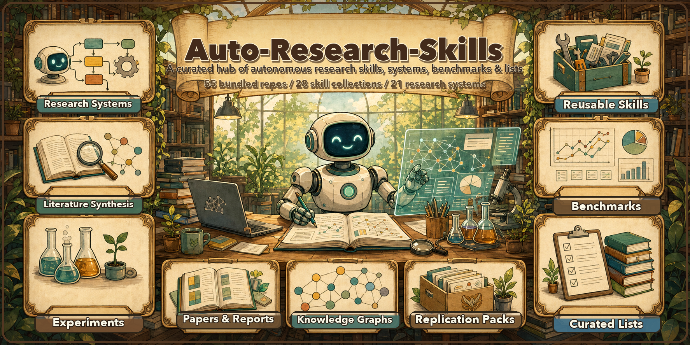

<div align="center">
  
</div>

<h1 align="center">Auto-Research-Skills</h1>

<p align="center">
  <b>A curated hub of autonomous-research <i>skills</i> & agents</b> — from idea → experiment → paper, on autopilot.
</p>

<p align="center">
  <a href="#research-skills--plugin-collections"></a>
</p>

<p align="center"><b>6,087 skills</b> bundled across <b>108 repos</b> — clone the whole research toolbox in one shot.</p>

<p align="center">
  <a href="#research-skills--plugin-collections"></a>
  <a href="#"></a>
  <a href="LICENSE"></a>
  
  <a href="CONTRIBUTING.md"></a>
  <a href="https://github.com/brycewang-stanford/StatsPAI"></a>
</p>

<p align="center"><b>English</b> · <a href="README.md">简体中文</a></p>

---

### Featured Skill

> **[Imbad0202/academic-research-skills](https://github.com/Imbad0202/academic-research-skills)** &nbsp;·&nbsp; ~52.7k stars &nbsp;·&nbsp; 🧩 bundled
> Academic Research Skills for Claude Code — a full **research → write → review → revise → finalize** pipeline, covering literature review and peer review. Vendored here at [`skills/academic-research-skills`](skills/academic-research-skills).

---

## 🏆 Top 20 by Stars

<!-- TOP20:START -->
> The 20 most-starred bundled repos, auto-refreshed weekly by [`scripts/update-stars.py`](scripts/update-stars.py) (last: 2026-10-20). Full ranking in [STARS.md](STARS.md).

| # | Repo | ⭐ Stars | Type | Bundled at |
|:-:|---|--:|:-:|---|
| 🥇 | [bytedance/deer-flow](https://github.com/bytedance/deer-flow) | 84.2k | System | [`systems/deer-flow`](systems/deer-flow) |
| 🥈 | [mvanhorn/last30days-skill](https://github.com/mvanhorn/last30days-skill) | 64.8k | Skills | [`skills/last30days`](skills/last30days) |
| 🥉 | [Imbad0202/academic-research-skills](https://github.com/Imbad0202/academic-research-skills) | 53.0k | Skills | [`skills/academic-research-skills`](skills/academic-research-skills) |
| 4 | [K-Dense-AI/scientific-agent-skills](https://github.com/K-Dense-AI/scientific-agent-skills) | 53.0k | Skills | [`skills/scientific-agent-skills`](skills/scientific-agent-skills) |
| 5 | [Yuan1z0825/nature-skills](https://github.com/Yuan1z0825/nature-skills) | 49.4k | Skills | [`skills/nature-skills`](skills/nature-skills) |
| 6 | [stanford-oval/storm](https://github.com/stanford-oval/storm) | 31.7k | System | [`systems/storm`](systems/storm) |
| 7 | [assafelovic/gpt-researcher](https://github.com/assafelovic/gpt-researcher) | 30.2k | System | [`systems/gpt-researcher`](systems/gpt-researcher) |
| 8 | [dzhng/deep-research](https://github.com/dzhng/deep-research) | 19.8k | System | [`systems/deep-research`](systems/deep-research) |
| 9 | [wanshuiyin/Auto-claude-code-research-in-sleep](https://github.com/wanshuiyin/Auto-claude-code-research-in-sleep) | 17.7k | Skills | [`skills/aris`](skills/aris) |
| 10 | [HKUDS/DeepCode](https://github.com/HKUDS/DeepCode) | 16.7k | System | [`systems/deepcode`](systems/deepcode) |
| 11 | [SakanaAI/AI-Scientist](https://github.com/SakanaAI/AI-Scientist) | 14.8k | System | [`systems/ai-scientist`](systems/ai-scientist) |
| 12 | [aiming-lab/AutoResearchClaw](https://github.com/aiming-lab/AutoResearchClaw) | 14.7k | System | [`systems/autoresearchclaw`](systems/autoresearchclaw) |
| 13 | [Orchestra-Research/AI-Research-SKILLs](https://github.com/Orchestra-Research/AI-Research-SKILLs) | 13.7k | Skills | [`skills/ai-research-skills`](skills/ai-research-skills) |
| 14 | [Imbad0202/academic-research-skills-codex](https://github.com/Imbad0202/academic-research-skills-codex) | 13.2k | Skills | [`skills/academic-research-skills-codex`](skills/academic-research-skills-codex) |
| 15 | [langchain-ai/open_deep_research](https://github.com/langchain-ai/open_deep_research) | 12.7k | System | [`systems/open-deep-research`](systems/open-deep-research) |
| 16 | [HKUSTDial/Supervisor-Skills](https://github.com/HKUSTDial/Supervisor-Skills) | 10.1k | Skills | [`skills/supervisor-skills`](skills/supervisor-skills) |
| 17 | [companion-inc/feynman](https://github.com/companion-inc/feynman) | 10.0k | Skills | [`skills/feynman`](skills/feynman) |
| 18 | [Future-House/paper-qa](https://github.com/Future-House/paper-qa) | 9.4k | System | [`systems/paper-qa`](systems/paper-qa) |
| 19 | [LearningCircuit/local-deep-research](https://github.com/LearningCircuit/local-deep-research) | 9.4k | System | [`systems/local-deep-research`](systems/local-deep-research) |
| 20 | [Master-cai/Research-Paper-Writing-Skills](https://github.com/Master-cai/Research-Paper-Writing-Skills) | 7.6k | Skills | [`skills/paper-writing-skills`](skills/paper-writing-skills) |
<!-- TOP20:END -->

---

> **What is this?** A community-curated hub for **autonomous research** — reusable skills, full end-to-end systems, domain-science agents, evaluation benchmarks, and curated lists — packaged so that coding agents (Claude Code, Codex, OpenClaw, and any LLM agent) can plug them in directly. **6,087 skills** across **108 repos** are vendored here as **git submodules** (shallow), organized into [`skills/`](skills/), [`systems/`](systems/), [`benchmarks/`](benchmarks/), and [`lists/`](lists/), so you can clone the whole toolbox in one shot.

```bash
# recommended: clone first, then let setup.sh handle top-level + nested submodules
git clone https://github.com/brycewang-stanford/Auto-Research-Skills.git
cd Auto-Research-Skills
./setup.sh

# already cloned? refresh missing submodules
./setup.sh

# install a collision-free starter kit for one research stage
python3 tools/build_starter_kits.py --install literature --dest ~/.claude/skills
```

> 🧰 **New here?** Start with [**catalog/STARTER-KITS.md**](catalog/STARTER-KITS.md): five deep, safety-gated, non-colliding skills for each of 12 research stages. 🗺️ What changed in the field recently is in [**the Q3 2026 update**](docs/landscape-2026.md#q3-2026-update-july--october).

## Table of Contents

- [🏆 Top 20 by Stars](#-top-20-by-stars)
- [End-to-End Autonomous Research Systems](#end-to-end-autonomous-research-systems)
- [Deep Research & Literature Synthesis](#deep-research--literature-synthesis)
- [Automated Experiment & Code Agents](#automated-experiment--code-agents)
- [Domain-Specific Science Agents](#domain-specific-science-agents)
- [Research Skills & Plugin Collections](#research-skills--plugin-collections)
- [Benchmarks & Evaluation](#benchmarks--evaluation)
- [Awesome Lists & Surveys](#awesome-lists--surveys)
- [Bundled Repos (submodules)](#bundled-repos-submodules)
  - [Skills & Plugin Collections](#skills--plugin-collections-skills)
  - [Systems & Agents](#systems--agents-systems)
  - [Benchmarks & Evaluation](#benchmarks--evaluation-benchmarks)
  - [Lists & Surveys](#lists--surveys-lists)
- [Contributing](#contributing)
- [License](#license)

> **Legend:** 🧩 = vendored here as a submodule.
> **Note:** the authoritative vendored inventory is [Bundled Repos](#bundled-repos-submodules). In the Research Skills table, unmarked rows are tracked candidates or useful adjacent projects.

---

## End-to-End Autonomous Research Systems

> Projects that automate the *full* research lifecycle: idea → experiment → paper → review.

| Project | Stars | Stack | Notes |
|---|---|---|---|
| [karpathy/autoresearch](https://github.com/karpathy/autoresearch) | ~98.1k | Python | Karpathy's overnight loop where AI agents autonomously propose, run & evaluate experiments on single-GPU nanochat LLM training. |
| [SakanaAI/AI-Scientist](https://github.com/SakanaAI/AI-Scientist) | ~14.8k | Python | Generate ideas, run experiments, write & auto-review papers. |
| [aiming-lab/AutoResearchClaw](https://github.com/aiming-lab/AutoResearchClaw) | ~14.7k | Agent | Fully autonomous & self-evolving research, from idea to paper. |
| [SakanaAI/AI-Scientist-v2](https://github.com/SakanaAI/AI-Scientist-v2) | ~7.4k | Python | v2 — agentic tree-search, workshop-grade papers, less template-bound. |
| [alphaXiv/OpenResearch](https://github.com/alphaXiv/OpenResearch) 🧩 | ~7.4k | Rust · TS | Turn Claude Code / Codex / OpenCode / Cursor into research agents; local-first, every run in a git worktree. Ships opt-out telemetry. |
| [SamuelSchmidgall/AgentLaboratory](https://github.com/SamuelSchmidgall/AgentLaboratory) | ~5.9k | Python | LLM agents as research assistants across the full pipeline. |
| [HKUDS/AI-Researcher](https://github.com/HKUDS/AI-Researcher) | ~5.8k | Python | NeurIPS 2025 — autonomous scientific innovation, idea → paper. |
| [sapientinc/PRAXIST](https://github.com/sapientinc/PRAXIST) | ~5.5k | Python | Parallel research peers on measurable, computer-executable research. Fair Source license (not OSI); list-only. |
| [aipoch/open-science](https://github.com/aipoch/open-science) | ~5.3k | TypeScript | Open-source, local-first research workbench (Claude-Science-style) with skills, MCP tools and Python/R execution. App, list-only. |
| [EvoScientist/EvoScientist](https://github.com/EvoScientist/EvoScientist) 🧩 | ~5.0k | Python | Self-evolving multi-agent AI scientists with persistent memory for iterative "vibe research." |
| [ResearAI/DeepScientist](https://github.com/ResearAI/DeepScientist) | ~3.4k | TS · Python | Local-first autonomous research studio: baseline reproduction → experiments → paper-ready output. |
| [EvoMap/AutoResearch](https://github.com/EvoMap/AutoResearch) 🧩 | ~3.2k | Python | Idea → paper-ready evidence with ≥3-model idea review, negative-result retention, and resumable state. |
| [OpenNSWM-Lab/FAROS](https://github.com/OpenNSWM-Lab/FAROS) | ~3.0k | Python | Blueprint-driven AutoResearch runtime: idea → experiments → paper writing → peer review. |
| [InternScience/InternAgent](https://github.com/InternScience/InternAgent) | ~1.5k | Python | Unified agentic framework for long-horizon, cross-domain autonomous scientific discovery. |
| [K-Dense-AI/k-dense-byok](https://github.com/K-Dense-AI/k-dense-byok) | ~1.4k | TypeScript | Desktop AI co-scientist built on the bundled scientific-agent-skills. List-only (tied to a vendored pack). |
| [OpenRaiser/NanoResearch](https://github.com/OpenRaiser/NanoResearch) | ~1.3k | Python | Lightweight autonomous AI research assistant (skills/agent-based), topic → end-to-end research. |
| [SakanaAI/AI-Scientist-v3](https://github.com/SakanaAI/AI-Scientist-v3) 🧩 | ~408 | Python · Docker | v3 "Agentic Scientist": orchestrates coding agents through a skills-driven, Dockerized six-phase pipeline (arXiv 2610.18933). |
| [zhu-minjun/Researcher](https://github.com/zhu-minjun/Researcher) | ~406 | Python | CycleResearcher — iterative research-and-peer-review loop that improves research via automated review. |
| [Sibyl-Research-Team/AutoResearch-SibylSystem](https://github.com/Sibyl-Research-Team/AutoResearch-SibylSystem) | ~287 | Claude Code | Self-evolving autonomous research system, Claude-Code native. |
| [ulab-uiuc/research-town](https://github.com/ulab-uiuc/research-town) | ~214 | Python | ICML 2025 — multi-agent simulator of a human research community. |
| [tsinghua-fib-lab/OmniScientist](https://github.com/tsinghua-fib-lab/OmniScientist) | ~207 | Python | AI-scientist ecosystem encoding human research infrastructure to automate ideas, lit review, experiments & writing. |

## Deep Research & Literature Synthesis

> Automated information gathering, literature review, and cited report generation.

| Project | Stars | Stack | Notes |
|---|---|---|---|
| [bytedance/deer-flow](https://github.com/bytedance/deer-flow) | ~84.1k | LangGraph | Deep research w/ human-in-the-loop. |
| [stanford-oval/storm](https://github.com/stanford-oval/storm) | ~31.7k | Python | Wikipedia-style long-form report synthesis. |
| [assafelovic/gpt-researcher](https://github.com/assafelovic/gpt-researcher) | ~30.2k | Python | Plan → scrape → cited report. The classic. |
| [dzhng/deep-research](https://github.com/dzhng/deep-research) | ~19.8k | TypeScript | The simplest iterative deep-research agent — refines its own direction. |
| [langchain-ai/open_deep_research](https://github.com/langchain-ai/open_deep_research) | ~12.7k | LangGraph | Open, configurable deep-research agent. |
| [Future-House/paper-qa](https://github.com/Future-House/paper-qa) | ~9.4k | Python | PaperQA2 — high-accuracy RAG over scientific PDFs with citations. |
| [LearningCircuit/local-deep-research](https://github.com/LearningCircuit/local-deep-research) | ~9.3k | Python | Local & private deep research; arXiv + PubMed, ~95% on SimpleQA. |
| [nickscamara/open-deep-research](https://github.com/nickscamara/open-deep-research) | ~6.3k | TypeScript | Open deep-research clone reasoning over Firecrawl-extracted web data. |
| [HKUDS/Auto-Deep-Research](https://github.com/HKUDS/Auto-Deep-Research) | ~1.8k | Agent | Low-cost, fully-automated personal research assistant. |
| [AkariAsai/OpenScholar](https://github.com/AkariAsai/OpenScholar) | ~1.7k | Python | Retrieval-augmented LM system that synthesizes scientific literature with grounded citations (AllenAI/UW). |
| [khoj-ai/openpaper](https://github.com/khoj-ai/openpaper) | ~504 | TypeScript | AI workbench to read, annotate & run literature reviews over your paper library. |
| [AutoSurveys/AutoSurvey](https://github.com/AutoSurveys/AutoSurvey) | ~478 | Python | Multi-stage pipeline for automated literature-survey generation. |

## Automated Experiment & Code Agents

> Coding, experiment execution, and iterative optimization on autopilot.

| Project | Stars | Stack | Notes |
|---|---|---|---|
| [going-doer/Paper2Code](https://github.com/going-doer/Paper2Code) | ~5.0k | Python | PaperCoder — turns an ML paper into a runnable code repository. |
| [ruc-datalab/DeepAnalyze](https://github.com/ruc-datalab/DeepAnalyze) 🧩 | ~4.7k | Python | "First agentic LLM for autonomous data science" — analyzes data & auto-generates full analysis reports. |
| [TheBlewish/Automated-AI-Web-Researcher-Ollama](https://github.com/TheBlewish/Automated-AI-Web-Researcher-Ollama) | ~3.0k | Ollama | Local-LLM automated web researcher. |
| [starpig1129/DATAGEN](https://github.com/starpig1129/DATAGEN) | ~1.8k | LangGraph | AI-driven multi-agent research assistant automating hypothesis generation, data analysis & report writing. |
| [WecoAI/aideml](https://github.com/WecoAI/aideml) | ~1.6k | Python | AIDE — ML-engineering agent; treats modeling as code-optimization search. |
| [Xiangyue-Zhang/auto-deep-researcher-24x7](https://github.com/Xiangyue-Zhang/auto-deep-researcher-24x7) | ~1.1k | Agent | Runs DL experiments 24/7, Leader-Worker, constant-size memory. |
| [RUC-NLPIR/Arbor](https://github.com/RUC-NLPIR/Arbor) 🧩 | ~1.1k | Python | Generalist autonomous research agent: hypothesis-tree experiment optimization; ships a Codex/Claude skill suite. |
| [Just-Curieous/Curie](https://github.com/Just-Curieous/Curie) | ~371 | Python | Rigorous, reproducible experimentation agent for ML research. |

## Domain-Specific Science Agents

> Agents that conduct real scientific work in a specific domain (bio, chemistry, multi-agent labs).

| Project | Stars | Domain | Notes |
|---|---|---|---|
| [snap-stanford/Biomni](https://github.com/snap-stanford/Biomni) | ~4.0k | Biomedicine | General-purpose biomedical AI agent across 150+ tools/databases. |
| [ur-whitelab/chemcrow-public](https://github.com/ur-whitelab/chemcrow-public) | ~965 | Chemistry | LLM chemistry agent for synthesis, drug discovery, materials. |
| [zou-group/virtual-lab](https://github.com/zou-group/virtual-lab) | ~753 | Multi-agent | A team of LLM "scientists" running interdisciplinary research (Stanford). |
| [Future-House/robin](https://github.com/Future-House/robin) | ~743 | Biomedicine | Multi-agent discovery; proposed a validated dry-AMD drug candidate. |
| [lamm-mit/SciAgentsDiscovery](https://github.com/lamm-mit/SciAgentsDiscovery) | ~638 | Materials | MIT — multi-agent automated scientific discovery & hypothesis generation. |
| [GENTEL-lab/OriGene](https://github.com/GENTEL-lab/OriGene) | ~230 | Biomedicine | Self-evolving multi-agent "virtual disease biologist" for mechanism-guided therapeutic-target discovery (non-commercial license). |
| [gomesgroup/coscientist](https://github.com/gomesgroup/coscientist) | ~212 | Chemistry | Autonomous chemical research with LLMs (Nature 2023). |

## Research Skills & Plugin Collections

> Reusable skill sets and plugins that drop into coding agents.

| Project | Stars | Stack | Notes |
|---|---|---|---|
| [Imbad0202/academic-research-skills](https://github.com/Imbad0202/academic-research-skills) 🧩 | ~52.7k | Claude Code · Python | **Featured.** Academic research → write → review → revise → finalize pipeline. |
| [Yuan1z0825/nature-skills](https://github.com/Yuan1z0825/nature-skills) 🧩 | ~49.1k | Claude Code · Python | Nature-grade academic phrasing + scientific figure plotting; Claude & Codex. |
| [wanshuiyin/Auto-claude-code-research-in-sleep](https://github.com/wanshuiyin/Auto-claude-code-research-in-sleep) 🧩 | ~17.7k | Markdown skills | ARIS — cross-model review loops, idea discovery, experiment automation. No framework lock-in. |
| [companion-inc/feynman](https://github.com/companion-inc/feynman) 🧩 | ~10.0k | CLI · Codex · Claude Code | Open-source AI research agent (CLI) on Pi + alphaXiv; 20 research skills — lit review, deep research, replication, peer review — installable into Codex/Claude. |
| [Galaxy-Dawn/claude-scholar](https://github.com/Galaxy-Dawn/claude-scholar) 🧩 | ~5.8k | Claude Code · MCP | Semi-automated research assistant; Zotero + Obsidian + MCP integration. |
| [54yyyu/zotero-mcp](https://github.com/54yyyu/zotero-mcp) 🧩 | ~5.5k | MCP · Python | Connect your Zotero library to any MCP agent — discuss papers, summarize, analyze citations. |
| [Norman-bury/research-writing-skill](https://github.com/Norman-bury/research-writing-skill) 🧩 | ~3.5k | Claude Code · Python | Popular Chinese-community research-writing assistant (科研写作助手): structure, polishing, figure/table text, submission prep. |
| [Adkid-Zephyr/anti-defensive-writing-Skill](https://github.com/Adkid-Zephyr/anti-defensive-writing-Skill) | ~3.5k | Agent Skills | Lightweight anti-defensive / anti-hedging academic-writing principles (CN/EN). Prompt-style; list-only. |
| [google-deepmind/science-skills](https://github.com/google-deepmind/science-skills) 🧩 | ~3.3k | Agent Skills · Python | Google DeepMind's science skill pack — 40 grounded, token-efficient skills over AlphaGenome, AFDB, UniProt and 30+ databases/tools. |
| [blazickjp/arxiv-mcp-server](https://github.com/blazickjp/arxiv-mcp-server) 🧩 | ~3.2k | MCP | Search & retrieve arXiv papers directly inside any MCP-capable agent. |
| [mikubaka88/CCFA-Skills](https://github.com/mikubaka88/CCFA-Skills) 🧩 | ~3.1k | Claude Code · LaTeX | Skill family for top-tier CS venues (CCF-A): research storyline, idea review, experiment design, integrity audit, LaTeX templates. |
| [openags/paper-search-mcp](https://github.com/openags/paper-search-mcp) 🧩 | ~2.9k | MCP · Python | MCP + CLI + skills to search & download papers across arXiv, PubMed, bioRxiv, medRxiv, and more. |
| [K-Dense-AI/claude-scientific-writer](https://github.com/K-Dense-AI/claude-scientific-writer) 🧩 | ~2.5k | Claude Code · Python | General-purpose scientific writer. |
| [AIScientists-Dev/academic-humanizer](https://github.com/AIScientists-Dev/academic-humanizer) | ~2.2k | Claude · Codex · MorphMind | Strips generic "AI-writing tells" from papers and NSF/NIH grant proposals while keeping scholarly voice and claim-evidence alignment. |
| [pedrohcgs/claude-code-my-workflow](https://github.com/pedrohcgs/claude-code-my-workflow) 🧩 | ~1.7k | Claude Code · LaTeX/R | Fork-ready academic template: multi-agent review, quality gates, replication. |
| [mims-harvard/ToolUniverse](https://github.com/mims-harvard/ToolUniverse) | ~1.7k | Python · Claude plugin | Harvard's biomedical tool universe, now shipped as a Claude plugin with 500+ skills. List-only pending a collision review. |
| [lishix520/academic-paper-skills](https://github.com/lishix520/academic-paper-skills) 🧩 | ~1.4k | Claude Code · Python | Systematic framework for planning & writing academic papers. |
| [huangkiki/dailypaper-skills](https://github.com/huangkiki/dailypaper-skills) 🧩 | ~1.3k | Agent Skills · Python | Daily paper discovery, critical reviews, and connected research notes (EN/ZH). |
| [LeonChaoX/qinyan-academic-skills](https://github.com/LeonChaoX/qinyan-academic-skills) | ~964 | Claude Code · Python | "沁言" academic library — 177 research agents. |
| [mshumer/autonomous-researcher](https://github.com/mshumer/autonomous-researcher) 🧩 | ~826 | Agent | Lightweight autonomous research agent. |
| [andrehuang/research-companion](https://github.com/andrehuang/research-companion) 🧩 | ~721 | Claude Code | Strategic research-thinking agents: idea evaluation, triage, brainstorming. |
| [Light0305/Light-skills](https://github.com/Light0305/Light-skills) 🧩 | ~659 | Claude Code · Codex | Full-pipeline research pack: 28 skills from literature review to submission, with verifiable knowledge bases and adversarial self-checks. |
| [anthropics/life-sciences](https://github.com/anthropics/life-sciences) | ~623 | Claude Code marketplace | Official Claude-for-Life-Sciences marketplace (scvi-tools, Nextflow, single-cell QC, clinical protocols). No license file; list-only. |
| [Boom5426/Nature-Paper-Skills](https://github.com/Boom5426/Nature-Paper-Skills) 🧩 | ~596 | Claude Code · TeX | Draft, revise, audit & resubmit skills for Nature-style papers. |
| [lllllllama/RigorPilot-Skills](https://github.com/lllllllama/RigorPilot-Skills) 🧩 | ~485 | Agent Skills · Python | README-first paper reproduction with bounded execution and an auditable evidence trail. |
| [NVIDIA-BioNeMo/bionemo-agent-toolkit](https://github.com/NVIDIA-BioNeMo/bionemo-agent-toolkit) 🧩 | ~484 | Agent Skills · NIM | NVIDIA BioNeMo NIM skills (Boltz-2, DiffDock, Evo2, GenMol, OpenFold3, …) for GPU structural biology & genomics. Skills CC-BY-4.0. |
| [EvoScientist/EvoSkills](https://github.com/EvoScientist/EvoSkills) | ~481 | Agent Skills | Installable skill and knowledge packs for EvoScientist-style scientific workflows. |
| [TobiasLee/Rebuttal-Skill](https://github.com/TobiasLee/Rebuttal-Skill) | ~480 | Agent Skills | Dedicated peer-review rebuttal skill — fills a thin spot in the ecosystem. No license; list-only. |
| [lingzhi227/agent-research-skills](https://github.com/lingzhi227/agent-research-skills) | ~414 | Claude Code · Python | Systematic academic deep-research skills. |
| [K-Dense-AI/science-superpowers](https://github.com/K-Dense-AI/science-superpowers) 🧩 | ~359 | Agent Skills | Research-process discipline for agents — pre-registration over TDD, feasibility-first planning, anomaly investigation. |
| [LMDHQ-0420/ResearchPilot-Skills](https://github.com/LMDHQ-0420/ResearchPilot-Skills) | ~317 | Claude Code · Shell | Automated 7-phase academic workflow: direction exploration, lit review, ideas, experiment design, code, paper writing. |
| [guhaohao0991/PaperClaw](https://github.com/guhaohao0991/PaperClaw) | ~252 | OpenClaw · Python | OpenClaw skill that generates topic-specific paper search-review-critique expert agents. |
| [SNL-UCSB/paper-writing-skill](https://github.com/SNL-UCSB/paper-writing-skill) | ~240 | Claude Code · Shell | Encodes editorial principles and a 5-stage pipeline (Brainstorm → Draft 0 → Evaluate → Write → Compress) for research papers. |
| [ai4s-research/ai4s-skills](https://github.com/ai4s-research/ai4s-skills) 🧩 | ~239 | Claude Code · Python | Seven "AI for Science" skills chaining topic exploration → literature survey → runnable experiments → paper writing → integrity audit. |
| [Stars-OC/thesis-creator](https://github.com/Stars-OC/thesis-creator) | ~233 | Claude Code · Python | Chinese thesis-writing skill (content, ER diagrams, flowcharts) with AIGC-detection / plagiarism-rate reduction for undergrad theses. |
| [andrehuang/academic-writing-agents](https://github.com/andrehuang/academic-writing-agents) | ~218 | Claude Code | Multi-agent orchestrator with 10 specialist writing agents. |
| [voidful/academic-skills](https://github.com/voidful/academic-skills) | ~136 | Claude · Codex · Gemini · TeX | Full research skill suite: paper reading, idea generation, experiment design, proof/paper writing, peer review. |
| [poemswe/co-researcher](https://github.com/poemswe/co-researcher) 🧩 | ~132 | Claude Code · Codex · Gemini CLI | Multi-platform academic research suite with specialized agents and CLI workflows. |
| [openags/auto-research](https://github.com/openags/auto-research) 🧩 | ~11 | Agent + UI | Generalist "AI Scientist" across fields. |

## Benchmarks & Evaluation

> How good are these agents, really? Benchmarks for measuring autonomous-research and ML-engineering capability.

| Project | Stars | Measures | Notes |
|---|---|---|---|
| [openai/mle-bench](https://github.com/openai/mle-bench) | ~1.8k | ML engineering | Benchmark measuring how well AI agents perform ML engineering (75 Kaggle-style competitions). |
| [openai/frontier-evals](https://github.com/openai/frontier-evals) | ~1.3k | Paper replication | Home of PaperBench (replicating ICML papers from scratch) and other OpenAI frontier evals. |
| [Ayanami0730/deep_research_bench](https://github.com/Ayanami0730/deep_research_bench) 🧩 | ~843 | Deep research | DeepResearch Bench — the de facto leaderboard for deep-research agents (report quality + citation accuracy). |
| [snap-stanford/MLAgentBench](https://github.com/snap-stanford/MLAgentBench) | ~356 | ML engineering | Agents performing end-to-end ML experimentation tasks. |
| [apexin-ai/ASI-Bench](https://github.com/apexin-ai/ASI-Bench) 🧩 | ~302 | Project-level research | 60 project-level research tasks across 11 domains; human guidance removed step by step (B1–B4). |
| [Future-House/aviary](https://github.com/Future-House/aviary) | ~284 | Scientific agent tasks | A language-agent gym of challenging scientific tasks (FutureHouse). |
| [InternScience/ResearchClawBench](https://github.com/InternScience/ResearchClawBench) | ~271 | Re-discovery → new discovery | 40 tasks / 10 domains scored by re-discovering a hidden paper's result; plugs into Claude Code/Codex/OpenClaw. ~2.5 GB of task data — list-only. |
| [scicode-bench/SciCode](https://github.com/scicode-bench/SciCode) 🧩 | ~241 | Scientific coding | Challenges language models to code solutions for real research-grade scientific problems. |
| [OSU-NLP-Group/ScienceAgentBench](https://github.com/OSU-NLP-Group/ScienceAgentBench) | ~178 | Data-driven science | Rigorous benchmark of agents on real scientific tasks. |
| [allenai/discoverybench](https://github.com/allenai/discoverybench) | ~164 | Data-driven discovery | Can LLMs derive hypotheses from real datasets? (AI2) |
| [HKUST-KnowComp/NewtonBench](https://github.com/HKUST-KnowComp/NewtonBench) | ~159 | Scientific-law discovery | ICLR 2026 — generalizable scientific-law discovery in LLM agents via interactive experiments. |
| [Future-House/BixBench](https://github.com/Future-House/BixBench) | ~148 | Computational biology | Benchmark for LLM-based agents in computational biology / bioinformatics (FutureHouse). |
| [allenai/asta-bench](https://github.com/allenai/asta-bench) 🧩 | ~141 | Scientific discovery | AI2's AstaBench (ICLR 2026): 2,400+ problems spanning the scientific-discovery process. |
| [facebookresearch/airs-bench](https://github.com/facebookresearch/airs-bench) | ~125 | AI research | 20 end-to-end ML-research tasks scored against SOTA. CC-BY-NC-4.0 — list-only. |

## Awesome Lists & Surveys

| Project | Stars | Notes |
|---|---|---|
| [VoltAgent/awesome-agent-skills](https://github.com/VoltAgent/awesome-agent-skills) | ~36.0k | 1,000+ general agent skills from official teams and the community. Broad, not research-specific; list-only. |
| [webfuse-com/awesome-autoresearch](https://github.com/webfuse-com/awesome-autoresearch) | ~2.6k | Autoresearch / autonomous-improvement-loop systems (CC0). |
| [VILA-Lab/Dive-into-Claude-Code](https://github.com/VILA-Lab/Dive-into-Claude-Code) | ~2.2k | Systematic analysis of Claude Code for designing AI-agent systems. |
| [ai-boost/awesome-ai-for-science](https://github.com/ai-boost/awesome-ai-for-science) | ~2.0k | Curated AI-for-Science tools, datasets & frameworks across domains. |
| [handsome-rich/Awesome-Auto-Research-Tools](https://github.com/handsome-rich/Awesome-Auto-Research-Tools) | ~1.2k | The list that inspired this repo. |
| [DavidZWZ/Awesome-Deep-Research](https://github.com/DavidZWZ/Awesome-Deep-Research) | ~872 | ACL 2026 — agentic deep-research resources. |
| [worldbench/awesome-ai-auto-research](https://github.com/worldbench/awesome-ai-auto-research) | ~556 | A survey on AI auto-research. |
| [modelscope/Awesome-Vibe-Research](https://github.com/modelscope/Awesome-Vibe-Research) 🧩 | ~462 | ModelScope's open "vibe research" hub: agents, skills, workflows and tools across the research lifecycle (EN/ZH). |
| [scienceaix/deepresearch](https://github.com/scienceaix/deepresearch) | ~435 | Companion list to the Deep Research survey paper. |
| [kael-odin/awesome-academic-research-skills](https://github.com/kael-odin/awesome-academic-research-skills) 🧩 | ~163 | Daily-updated ranking of academic/research agent-skill repos (Claude Code / Codex / OpenCode), with a JSON feed. |
| [MinhaoXiong/awesome-automated-research](https://github.com/MinhaoXiong/awesome-automated-research) | ~125 | Curated list of autonomous research systems. |

---

## Bundled Repos (submodules)

**6,087 skills** across **108 repos** (most with 100+ stars) are vendored as shallow git submodules across four folders, sorted by stars within each. Run `./setup.sh` to fetch them all; use `ARS_SKIP_NESTED_SUBMODULES=1 ./setup.sh` when you only need the top-level bundles.

> Live ranking: see [**STARS.md**](STARS.md) — auto-refreshed weekly by [a GitHub Action](.github/workflows/update-stars.yml).
>
> Curation backlog: see [**CURATION.md**](CURATION.md) for candidate skills found via registry/GitHub research, review criteria, and the current safety checklist.
>
> 🗺️ For a map of the whole autonomous-research ecosystem and the logic behind the four-folder split, see [**docs/landscape-2026.md**](docs/landscape-2026.md).
>
> Maintainers: run `make check` before PRs (or the equivalent commands in [`CONTRIBUTING.md`](CONTRIBUTING.md)). `setup.sh` initializes top-level submodules first and then best-effort nested submodules declared by upstream repos, so one broken nested mapping does not block the whole checkout.
>
> Do not install every `skills/` submodule into one agent profile by default. Many upstream collections reuse the same skill names for different behavior, and name-based resolution can become undefined. Before combining collections, inspect [`catalog/collisions.json`](catalog/collisions.json) or serve the repo root and open [`site/collisions.html`](site/collisions.html).
>
> 🧰 **Don't know where to start?** [`catalog/STARTER-KITS.md`](catalog/STARTER-KITS.md) picks **5 deep, safety-gated, collision-free skills for each research stage**, covering ideation, literature, reading, experiments, analysis, writing, figures, review, citations, grants, slides and life-science tools. Install a stage with `python3 tools/build_starter_kits.py --install literature --dest ~/.claude/skills`.
>
> **Picking an academic-research skill?** Several bundled packages overlap. Start with [`skills/academic-research-skills`](skills/academic-research-skills) (the featured, most-starred pipeline). Pick [`skills/academic-research-skills-codex`](skills/academic-research-skills-codex) or [`skills/codex-academic-skills`](skills/codex-academic-skills) if you're on **Codex** rather than Claude Code; [`skills/franklee-academic-research-skills`](skills/franklee-academic-research-skills) if you work in **econ/finance**; [`skills/claude-code-my-workflow`](skills/claude-code-my-workflow) for a **LaTeX/Beamer + R, fork-ready** academic setup; [`skills/empirical-research-skills`](skills/empirical-research-skills) for **empirical social-science** workflows.

### Skills & Plugin Collections (`skills/`)

51 reusable skill sets and plugins that drop into coding agents.

| Path | Source | Stars | What it gives you |
|---|---|---|---|
| `skills/last30days` | [mvanhorn/last30days-skill](https://github.com/mvanhorn/last30days-skill) | ~64.6k | Research any topic across Reddit, X, YouTube, HN, Polymarket. |
| `skills/academic-research-skills` | [Imbad0202/academic-research-skills](https://github.com/Imbad0202/academic-research-skills) | ~52.7k | **Featured.** research → write → review → revise → finalize. |
| `skills/scientific-agent-skills` | [K-Dense-AI/scientific-agent-skills](https://github.com/K-Dense-AI/scientific-agent-skills) | ~52.6k | Ready-to-use agent skills for research, science, engineering, analysis, finance. |
| `skills/nature-skills` | [Yuan1z0825/nature-skills](https://github.com/Yuan1z0825/nature-skills) | ~49.1k | Nature-grade academic phrasing + scientific figure plotting (Claude & Codex). |
| `skills/aris` | [wanshuiyin/Auto-claude-code-research-in-sleep](https://github.com/wanshuiyin/Auto-claude-code-research-in-sleep) | ~17.7k | Markdown-only autonomous-ML-research skills. |
| `skills/ai-research-skills` | [Orchestra-Research/AI-Research-SKILLs](https://github.com/Orchestra-Research/AI-Research-SKILLs) | ~13.7k | Open library of AI research & engineering skills for any model. |
| `skills/academic-research-skills-codex` | [Imbad0202/academic-research-skills-codex](https://github.com/Imbad0202/academic-research-skills-codex) | ~13.1k | Codex-native academic research suite, human-in-the-loop. |
| `skills/feynman` | [companion-inc/feynman](https://github.com/companion-inc/feynman) | ~10.0k | Open-source AI research agent (CLI) on Pi + alphaXiv; 20 research skills installable into Codex/Claude. |
| `skills/supervisor-skills` | [HKUSTDial/Supervisor-Skills](https://github.com/HKUSTDial/Supervisor-Skills) | ~10.0k | "AI 科研副导师" — from idea to paper submission. |
| `skills/paper-writing-skills` | [Master-cai/Research-Paper-Writing-Skills](https://github.com/Master-cai/Research-Paper-Writing-Skills) | ~7.6k | ML/CV/NLP paper-writing skill package. |
| `skills/autoresearch` | [uditgoenka/autoresearch](https://github.com/uditgoenka/autoresearch) | ~6.6k | Claude Autoresearch skill — Karpathy-inspired autonomous goal-directed iteration; ships a command-safety guard. |
| `skills/claude-scholar` | [Galaxy-Dawn/claude-scholar](https://github.com/Galaxy-Dawn/claude-scholar) | ~5.8k | Semi-automated research assistant; Zotero + Obsidian + MCP. |
| `skills/zotero-mcp` | [54yyyu/zotero-mcp](https://github.com/54yyyu/zotero-mcp) | ~5.5k | MCP server connecting your Zotero library to any agent — discuss papers, summarize, analyze citations. |
| `skills/codex-academic-skills` | [zLanqing/codex-claude-academic-skills](https://github.com/zLanqing/codex-claude-academic-skills) | ~5.0k | Three academic skills: reading, writing, scientific computing. |
| `skills/empirical-research-skills` | [brycewang-stanford/Auto-Empirical-Research-Skills](https://github.com/brycewang-stanford/Auto-Empirical-Research-Skills) | ~4.7k | 23k+ agent skills for empirical research across social sciences. |
| `skills/research-writing-skill` | [Norman-bury/research-writing-skill](https://github.com/Norman-bury/research-writing-skill) | ~3.5k | Popular Chinese-community research-writing assistant (科研写作助手): structure, polishing, figure/table text, submission prep. |
| `skills/deepmind-science-skills` | [google-deepmind/science-skills](https://github.com/google-deepmind/science-skills) | ~3.3k | Google DeepMind's science skill pack — 40 grounded, token-efficient skills over AlphaGenome, AFDB, UniProt and 30+ databases/tools. |
| `skills/arxiv-mcp-server` | [blazickjp/arxiv-mcp-server](https://github.com/blazickjp/arxiv-mcp-server) | ~3.2k | MCP server to search & fetch arXiv papers from any agent. |
| `skills/ccfa-skills` | [mikubaka88/CCFA-Skills](https://github.com/mikubaka88/CCFA-Skills) | ~3.1k | Skill family for top-tier CS venues (CCF-A): research storyline, idea review, experiment design, integrity audit, LaTeX templates. |
| `skills/paper-search-mcp` | [openags/paper-search-mcp](https://github.com/openags/paper-search-mcp) | ~2.9k | Multi-source paper search & download (arXiv, PubMed, bioRxiv, …) as an MCP server, CLI, and skills. |
| `skills/academicforge` | [HughYau/AcademicForge](https://github.com/HughYau/AcademicForge) | ~2.6k | Curated skill collection for academic writing & research. |
| `skills/claude-scientific-writer` | [K-Dense-AI/claude-scientific-writer](https://github.com/K-Dense-AI/claude-scientific-writer) | ~2.5k | General-purpose scientific writer (sibling of `scientific-agent-skills`). |
| `skills/deep-research-skills` | [Weizhena/Deep-Research-skills](https://github.com/Weizhena/Deep-Research-skills) | ~2.4k | Structured deep-research skill with human-in-the-loop (Claude Code / Codex). |
| `skills/medical-research-skills` | [aipoch/medical-research-skills](https://github.com/aipoch/medical-research-skills) | ~2.0k | Medical research: protocol design, data analysis, evidence. |
| `skills/claude-code-my-workflow` | [pedrohcgs/claude-code-my-workflow](https://github.com/pedrohcgs/claude-code-my-workflow) | ~1.7k | Fork-ready academic Claude Code template (LaTeX/Beamer + R); multi-agent QA & replication. |
| `skills/academic-paper-skills` | [lishix520/academic-paper-skills](https://github.com/lishix520/academic-paper-skills) | ~1.4k | Systematic framework for planning & writing academic papers. |
| `skills/dailypaper-skills` | [huangkiki/dailypaper-skills](https://github.com/huangkiki/dailypaper-skills) | ~1.3k | Daily paper discovery, critical reviews, and connected research notes (EN/ZH). |
| `skills/x-research-skill` | [rohunvora/x-research-skill](https://github.com/rohunvora/x-research-skill) | ~1.2k | X/Twitter research: agentic search, thread following. |
| `skills/claude-deep-research-skill` | [199-biotechnologies/claude-deep-research-skill](https://github.com/199-biotechnologies/claude-deep-research-skill) | ~1.2k | Enterprise deep-research, 8-phase pipeline, source credibility. |
| `skills/scienceclaw` | [beita6969/ScienceClaw](https://github.com/beita6969/ScienceClaw) | ~1.0k | Self-evolving AI research colleague, 285 skills. |
| `skills/research-skills` | [luwill/research-skills](https://github.com/luwill/research-skills) | ~871 | Common research processes encapsulated as agent skills. |
| `skills/research-companion` | [andrehuang/research-companion](https://github.com/andrehuang/research-companion) | ~721 | Strategic research-thinking agents: idea evaluation, triage, brainstorming. |
| `skills/light-skills` | [Light0305/Light-skills](https://github.com/Light0305/Light-skills) | ~659 | 28 skills covering literature review → writing → review → submission, plus 9 verifiable knowledge bases. |
| `skills/nature-paper-skills` | [Boom5426/Nature-Paper-Skills](https://github.com/Boom5426/Nature-Paper-Skills) | ~596 | Draft, revise, audit & resubmit skills for Nature-style papers. |
| `skills/awesome-scientific-skills` | [InternScience/Awesome-Scientific-Skills](https://github.com/InternScience/Awesome-Scientific-Skills) | ~569 | Curated Agent Skills for scientific research. |
| `skills/research-units-pipeline` | [WILLOSCAR/research-units-pipeline-skills](https://github.com/WILLOSCAR/research-units-pipeline-skills) | ~513 | Research pipelines as semantic execution units. |
| `skills/ai-research-feedback` | [claesbackman/AI-research-feedback](https://github.com/claesbackman/AI-research-feedback) | ~503 | Claude Code skills for academic research review. |
| `skills/rigorpilot-skills` | [lllllllama/RigorPilot-Skills](https://github.com/lllllllama/RigorPilot-Skills) | ~485 | README-first paper reproduction with bounded execution and an auditable evidence trail. |
| `skills/bionemo-agent-toolkit` | [NVIDIA-BioNeMo/bionemo-agent-toolkit](https://github.com/NVIDIA-BioNeMo/bionemo-agent-toolkit) | ~484 | NVIDIA BioNeMo NIM skills (Boltz-2, DiffDock, Evo2, GenMol, OpenFold3, …) for GPU structural biology & genomics. Skills CC-BY-4.0. |
| `skills/claudeblattman` | [chrisblattman/claudeblattman](https://github.com/chrisblattman/claudeblattman) | ~465 | Claude Code for academics — skills, agents, setup guides. |
| `skills/oneresearchclaw` | [gaotiexinqu/OneResearchClaw](https://github.com/gaotiexinqu/OneResearchClaw) | ~450 | Any materials → fully autonomous, skill-driven research. |
| `skills/openclaw-search-skills` | [blessonism/openclaw-search-skills](https://github.com/blessonism/openclaw-search-skills) | ~437 | OpenClaw deep-search: multi-source search & extraction. |
| `skills/claude-skills-journalism` | [jamditis/claude-skills-journalism](https://github.com/jamditis/claude-skills-journalism) | ~423 | Journalism/media/academia skills: fact-checking, FOIA, data journalism, academic writing (54 skills). |
| `skills/phd-skills` | [fcakyon/phd-skills](https://github.com/fcakyon/phd-skills) | ~423 | Paper reproduction, experiment design, paper review. |
| `skills/academic-skills` | [chtc66/academic-skills](https://github.com/chtc66/academic-skills) | ~364 | Paper reading, survey writing, experiment summary, rebuttal. |
| `skills/science-superpowers` | [K-Dense-AI/science-superpowers](https://github.com/K-Dense-AI/science-superpowers) | ~359 | Research-process discipline for agents — pre-registration over TDD, feasibility-first planning, anomaly investigation. |
| `skills/research-plugins` | [wentorai/research-plugins](https://github.com/wentorai/research-plugins) | ~300 | 350+ academic research skills, MCP configs & plugins. |
| `skills/ai4s-skills` | [ai4s-research/ai4s-skills](https://github.com/ai4s-research/ai4s-skills) | ~246 | 7-skill AI-for-Science pipeline: topic exploration → survey → experiments → writing → integrity audit. |
| `skills/franklee-academic-research-skills` | [franklee16/academic-research-skills](https://github.com/franklee16/academic-research-skills) | ~223 | Claude Code skills for econ/finance academic research. |
| `skills/claude-research` | [flonat/claude-research](https://github.com/flonat/claude-research) | ~146 | PhD-grade Claude Code infrastructure: 50 skills + agents + hooks + rules (/bib-validate, /pre-submission-report, …). |
| `skills/co-researcher` | [poemswe/co-researcher](https://github.com/poemswe/co-researcher) | ~132 | Multi-platform research suite: literature review, methodology, synthesis, peer review, ethics, grants. |

### Systems & Agents (`systems/`)

38 end-to-end systems and autonomous agents — from idea to paper, deep-research report generation, domain-science labs, and 24/7 experiment runners.

| Path | Source | Stars | What it does |
|---|---|---|---|
| `systems/deer-flow` | [bytedance/deer-flow](https://github.com/bytedance/deer-flow) | ~84.1k | LangGraph deep-research SuperAgent w/ human-in-the-loop. |
| `systems/storm` | [stanford-oval/storm](https://github.com/stanford-oval/storm) | ~31.7k | Wikipedia-style long-form report synthesis (Stanford). |
| `systems/gpt-researcher` | [assafelovic/gpt-researcher](https://github.com/assafelovic/gpt-researcher) | ~30.2k | Plan → scrape → cited report. The classic. |
| `systems/deep-research` | [dzhng/deep-research](https://github.com/dzhng/deep-research) | ~19.8k | The simplest iterative deep-research agent; refines its own direction (TS). |
| `systems/deepcode` | [HKUDS/DeepCode](https://github.com/HKUDS/DeepCode) | ~16.7k | Open agentic coding: Paper2Code + Text2Web + Text2Backend. |
| `systems/ai-scientist` | [SakanaAI/AI-Scientist](https://github.com/SakanaAI/AI-Scientist) | ~14.8k | Generate ideas, run experiments, write & auto-review papers. |
| `systems/autoresearchclaw` | [aiming-lab/AutoResearchClaw](https://github.com/aiming-lab/AutoResearchClaw) | ~14.7k | Fully autonomous & self-evolving research, idea → paper. |
| `systems/open-deep-research` | [langchain-ai/open_deep_research](https://github.com/langchain-ai/open_deep_research) | ~12.7k | Open, configurable LangGraph deep-research agent. |
| `systems/paper-qa` | [Future-House/paper-qa](https://github.com/Future-House/paper-qa) | ~9.4k | PaperQA2 — high-accuracy RAG over scientific PDFs with citations. |
| `systems/local-deep-research` | [LearningCircuit/local-deep-research](https://github.com/LearningCircuit/local-deep-research) | ~9.3k | Local & private deep research; arXiv + PubMed, ~95% on SimpleQA. |
| `systems/ai-scientist-v2` | [SakanaAI/AI-Scientist-v2](https://github.com/SakanaAI/AI-Scientist-v2) | ~7.4k | v2 — agentic tree-search, workshop-grade papers. |
| `systems/openresearch` | [alphaXiv/OpenResearch](https://github.com/alphaXiv/OpenResearch) | ~7.4k | Turn Claude Code / Codex / OpenCode / Cursor into research agents; local-first, every run in a git worktree. Ships opt-out telemetry. |
| `systems/open-deep-research-firecrawl` | [nickscamara/open-deep-research](https://github.com/nickscamara/open-deep-research) | ~6.3k | Open deep-research clone over Firecrawl-extracted web data. |
| `systems/agent-laboratory` | [SamuelSchmidgall/AgentLaboratory](https://github.com/SamuelSchmidgall/AgentLaboratory) | ~5.9k | LLM agents as research assistants across the full pipeline. |
| `systems/ai-researcher` | [HKUDS/AI-Researcher](https://github.com/HKUDS/AI-Researcher) | ~5.8k | NeurIPS 2025 — autonomous scientific innovation, idea → paper. |
| `systems/paper2code` | [going-doer/Paper2Code](https://github.com/going-doer/Paper2Code) | ~5.0k | PaperCoder — turns an ML paper into a runnable code repository. |
| `systems/evoscientist` | [EvoScientist/EvoScientist](https://github.com/EvoScientist/EvoScientist) | ~5.0k | Self-evolving multi-agent AI scientists with persistent memory ("vibe research"). |
| `systems/deepanalyze` | [ruc-datalab/DeepAnalyze](https://github.com/ruc-datalab/DeepAnalyze) | ~4.7k | Agentic LLM for autonomous data science: analyze large data, one-click analyst reports. |
| `systems/biomni` | [snap-stanford/Biomni](https://github.com/snap-stanford/Biomni) | ~4.0k | General-purpose biomedical AI agent (150+ tools/databases). |
| `systems/evomap-autoresearch` | [EvoMap/AutoResearch](https://github.com/EvoMap/AutoResearch) | ~3.2k | Idea → paper-ready evidence with ≥3-model idea review, negative-result retention, and resumable state. |
| `systems/web-researcher-ollama` | [TheBlewish/Automated-AI-Web-Researcher-Ollama](https://github.com/TheBlewish/Automated-AI-Web-Researcher-Ollama) | ~3.0k | Local-LLM automated web researcher (Ollama). |
| `systems/auto-deep-research` | [HKUDS/Auto-Deep-Research](https://github.com/HKUDS/Auto-Deep-Research) | ~1.8k | Low-cost, fully-automated personal research assistant. |
| `systems/aideml` | [WecoAI/aideml](https://github.com/WecoAI/aideml) | ~1.6k | AIDE — ML-engineering agent; modeling as code-optimization search. |
| `systems/auto-deep-researcher-24x7` | [Xiangyue-Zhang/auto-deep-researcher-24x7](https://github.com/Xiangyue-Zhang/auto-deep-researcher-24x7) | ~1.1k | Runs DL experiments 24/7, Leader-Worker architecture. |
| `systems/arbor` | [RUC-NLPIR/Arbor](https://github.com/RUC-NLPIR/Arbor) | ~1.1k | Generalist autonomous research agent: hypothesis-tree experiment optimization; ships a Codex/Claude skill suite. |
| `systems/chemcrow` | [ur-whitelab/chemcrow-public](https://github.com/ur-whitelab/chemcrow-public) | ~965 | LLM chemistry agent for synthesis, drug discovery, materials. |
| `systems/autonomous-researcher` | [mshumer/autonomous-researcher](https://github.com/mshumer/autonomous-researcher) | ~826 | Lightweight autonomous research agent. |
| `systems/virtual-lab` | [zou-group/virtual-lab](https://github.com/zou-group/virtual-lab) | ~753 | A team of LLM "scientists" running interdisciplinary research (Stanford). |
| `systems/robin` | [Future-House/robin](https://github.com/Future-House/robin) | ~743 | FutureHouse multi-agent discovery; validated a dry-AMD drug candidate. |
| `systems/sciagents` | [lamm-mit/SciAgentsDiscovery](https://github.com/lamm-mit/SciAgentsDiscovery) | ~638 | MIT — multi-agent automated scientific discovery (materials). |
| `systems/autosurvey` | [AutoSurveys/AutoSurvey](https://github.com/AutoSurveys/AutoSurvey) | ~478 | Multi-stage pipeline for automated literature-survey generation. |
| `systems/ai-scientist-v3` | [SakanaAI/AI-Scientist-v3](https://github.com/SakanaAI/AI-Scientist-v3) | ~408 | v3 "Agentic Scientist": orchestrates coding agents through a skills-driven, Dockerized six-phase pipeline (arXiv 2610.18933). |
| `systems/curie` | [Just-Curieous/Curie](https://github.com/Just-Curieous/Curie) | ~371 | Rigorous, reproducible experimentation agent for ML research. |
| `systems/popper` | [snap-stanford/POPPER](https://github.com/snap-stanford/POPPER) | ~297 | Automated hypothesis testing via agentic sequential (Popperian) falsification — Stanford SNAP. ⚠️ no upstream license. |
| `systems/sibyl-system` | [Sibyl-Research-Team/AutoResearch-SibylSystem](https://github.com/Sibyl-Research-Team/AutoResearch-SibylSystem) | ~287 | Self-evolving autonomous research system, Claude-Code native. |
| `systems/research-town` | [ulab-uiuc/research-town](https://github.com/ulab-uiuc/research-town) | ~214 | ICML 2025 — simulator of a human research community. |
| `systems/coscientist` | [gomesgroup/coscientist](https://github.com/gomesgroup/coscientist) | ~212 | Autonomous chemical research with LLMs (Nature 2023). |
| `systems/auto-research` | [openags/auto-research](https://github.com/openags/auto-research) | ~11 | Generalist "AI Scientist" across fields, with UI. |

### Benchmarks & Evaluation (`benchmarks/`)

8 benchmarks for measuring how well autonomous agents actually do research and ML engineering.

| Path | Source | Stars | What it measures |
|---|---|---|---|
| `benchmarks/deep-research-bench` | [Ayanami0730/deep_research_bench](https://github.com/Ayanami0730/deep_research_bench) | ~843 | DeepResearch Bench — the de facto leaderboard for deep-research agents (report quality + citation accuracy). |
| `benchmarks/mlagentbench` | [snap-stanford/MLAgentBench](https://github.com/snap-stanford/MLAgentBench) | ~356 | Agents performing end-to-end ML experimentation tasks. |
| `benchmarks/asi-bench` | [apexin-ai/ASI-Bench](https://github.com/apexin-ai/ASI-Bench) | ~302 | 60 project-level research tasks across 11 domains; human guidance removed step by step (B1–B4). |
| `benchmarks/aviary` | [Future-House/aviary](https://github.com/Future-House/aviary) | ~284 | A language-agent gym of challenging scientific tasks (FutureHouse). |
| `benchmarks/scicode` | [scicode-bench/SciCode](https://github.com/scicode-bench/SciCode) | ~242 | Challenges language models to code solutions for real research-grade scientific problems. |
| `benchmarks/scienceagentbench` | [OSU-NLP-Group/ScienceAgentBench](https://github.com/OSU-NLP-Group/ScienceAgentBench) | ~178 | Rigorous benchmark of agents on real data-driven science tasks. |
| `benchmarks/discoverybench` | [allenai/discoverybench](https://github.com/allenai/discoverybench) | ~164 | Whether LLMs can derive hypotheses from real datasets (AI2). |
| `benchmarks/asta-bench` | [allenai/asta-bench](https://github.com/allenai/asta-bench) | ~141 | AI2's AstaBench (ICLR 2026): 2,400+ problems spanning the scientific-discovery process. |

### Lists & Surveys (`lists/`)

11 curated collections / survey repos on the auto-research landscape.

| Path | Source | Stars | What it is |
|---|---|---|---|
| `lists/awesome-autoresearch` | [webfuse-com/awesome-autoresearch](https://github.com/webfuse-com/awesome-autoresearch) | ~2.6k | Curated autoresearch / autonomous-improvement-loop systems (CC0). |
| `lists/dive-into-claude-code` | [VILA-Lab/Dive-into-Claude-Code](https://github.com/VILA-Lab/Dive-into-Claude-Code) | ~2.2k | Systematic analysis of Claude Code for designing AI-agent systems. |
| `lists/awesome-ai-for-science` | [ai-boost/awesome-ai-for-science](https://github.com/ai-boost/awesome-ai-for-science) | ~2.0k | Curated AI-for-Science tools, datasets & frameworks across domains. |
| `lists/autonomous-agents` | [tmgthb/Autonomous-Agents](https://github.com/tmgthb/Autonomous-Agents) | ~1.4k | Daily-updated index of autonomous-agent (LLM) research papers. |
| `lists/awesome-auto-research-tools` | [handsome-rich/Awesome-Auto-Research-Tools](https://github.com/handsome-rich/Awesome-Auto-Research-Tools) | ~1.2k | The list that inspired this repo. |
| `lists/awesome-deep-research` | [DavidZWZ/Awesome-Deep-Research](https://github.com/DavidZWZ/Awesome-Deep-Research) | ~872 | ACL 2026 — agentic deep-research resources. |
| `lists/awesome-ai-auto-research` | [worldbench/awesome-ai-auto-research](https://github.com/worldbench/awesome-ai-auto-research) | ~556 | A survey on AI auto-research. |
| `lists/awesome-vibe-research` | [modelscope/Awesome-Vibe-Research](https://github.com/modelscope/Awesome-Vibe-Research) | ~462 | ModelScope's open "vibe research" hub: agents, skills, workflows and tools across the research lifecycle (EN/ZH). |
| `lists/awesome-deep-research-survey` | [scienceaix/deepresearch](https://github.com/scienceaix/deepresearch) | ~435 | Companion list to the Deep Research survey paper. |
| `lists/awesome-academic-research-skills` | [kael-odin/awesome-academic-research-skills](https://github.com/kael-odin/awesome-academic-research-skills) | ~163 | Daily-updated ranking of academic/research agent-skill repos (Claude Code / Codex / OpenCode), with a JSON feed. |
| `lists/awesome-automated-research` | [MinhaoXiong/awesome-automated-research](https://github.com/MinhaoXiong/awesome-automated-research) | ~125 | Curated list of autonomous research systems. |

> Want your repo bundled? See [CONTRIBUTING](CONTRIBUTING.md) — open a PR adding a submodule under `skills/`, `systems/`, `benchmarks/`, or `lists/`.

## Contributing

PRs welcome! Add a tool to the right category, or vendor a skill as a submodule. See [CONTRIBUTING.md](CONTRIBUTING.md).

## License

[CC0 1.0 Universal](LICENSE) — public domain. The submodules retain their own licenses.
